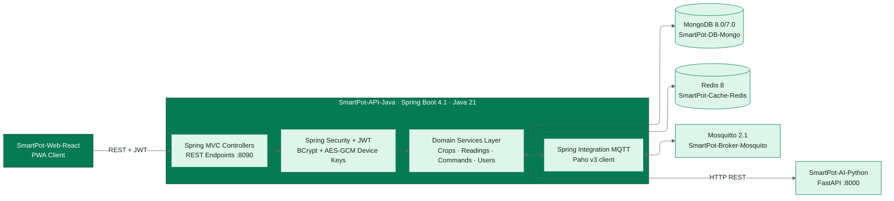
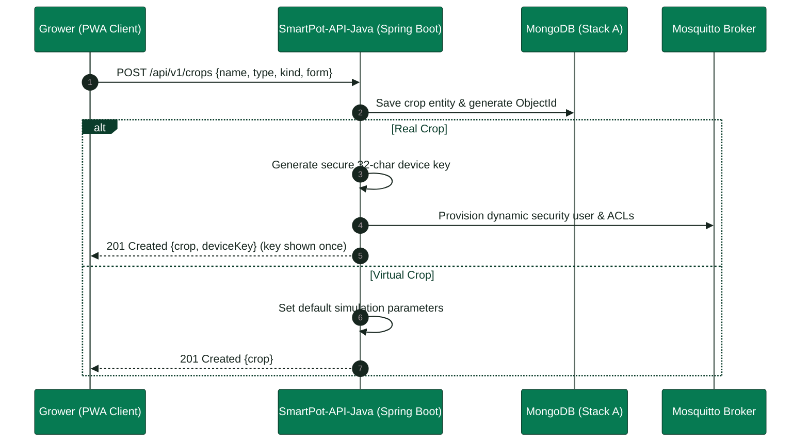
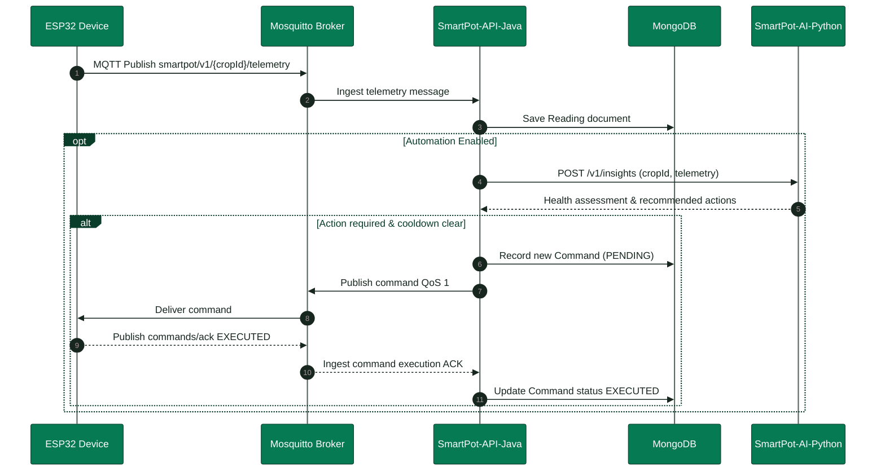
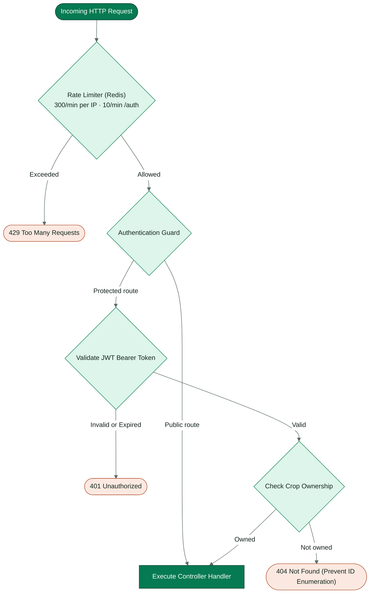

<!-- portada
eyebrow: Component Technical Documentation
titulo: SmartPot-API-Java (Legacy Stack A)
acento: API
subtitulo: Legacy Spring Boot Core API and MQTT Bridge
bajada: REST with JWT, MQTT broker bridge, physical and virtual crops, AI automation agent, notification channels, security, configuration, and operations of the legacy Stack A API.
documento: SmartPot-API-Java Documentation
version: 1.1 · October 2026
equipo: SmartPotTech
proyecto: smartpot.app
-->

# SmartPot-API-Java (Legacy Stack A)

> [!WARNING]
> **Legacy Component (Stack A)**: This service has been superseded in production by the canonical Go API ([`SmartPot-API`](https://github.com/SmartPotTech/SmartPot-API)). This document preserves the historical architecture and implementation details of the original Spring Boot 4.1 and Java 21 service.

## Document Summary

| Field                          | Value                                                                                                                                                                                                                                                                                                                                                                                                                                                   |
|--------------------------------|---------------------------------------------------------------------------------------------------------------------------------------------------------------------------------------------------------------------------------------------------------------------------------------------------------------------------------------------------------------------------------------------------------------------------------------------------------|
| Project                       | SmartPot · [smartpot.app](https://smartpot.app)                                                                                                                                                                                                                                                                                                                                                                                                         |
| Component                     | [SmartPot-API](https://github.com/SmartPotTech/SmartPot-API)                                                                                                                                                                                                                                                                                                                                                                                            |
| Version                       | 1.1 · octubre 2026                                                                                                                                                                                                                                                                                                                                                                                                                                      |
| Scope                        | API domains, physical and virtual crops, telemetry and command flow, security, configuration, testing, and operations                                                                                                                                                                                                                                                                                                                            |
| Platform Documentation | [Technical Documentation](https://github.com/SmartPotTech/.github/blob/main/docs/SmartPot_Technical_Documentation.md), [Project Journey](https://github.com/SmartPotTech/.github/blob/main/docs/SmartPot_Project_Journey.md), [Software Lifecycle](https://github.com/SmartPotTech/.github/blob/main/docs/SmartPot_Software_Lifecycle.md), and [Global Diagrams](https://github.com/SmartPotTech/.github/blob/main/docs/README.md#global-diagrams) |
| Maintenance                  | Generated from `docs/` in this repository via `.github/docs/tools`; updated with every component change                                                                                                                                                                                                                                                                                                                   |

<!-- parte: PART I | Component Overview -->

## 1. Purpose

### In Plain Terms

The API serves as the primary gateway of SmartPot. The PWA communicates via HTTPS; crop devices communicate via MQTT through the broker. The API stores telemetry readings, queries the AI assistant for agronomic health evaluations, dispatches actuation commands, provisions per-crop MQTT credentials, and delivers alerts through the PWA and Telegram. All user interactions route through this layer, scoped strictly to authenticated tenant accounts.

| Responsibility  | Mechanism                                                                                                                                                             |
|------------------|------------------------------------------------------------------------------------------------------------------------------------------------------------------|
| Accounts & Auth | Registration, JWT login, email password recovery, user profile, and cascaded account deletion                                                                  |
| Crops         | Physical or virtual (immutable once created), 6 species profiles, 4 system forms, live weather location, and automatic mode                              |
| Devices     | Per-crop MQTT tenant account with 192-bit AES-256-GCM encrypted credentials; Mosquitto dynamic provisioning                                                            |
| Telemetry         | MQTT telemetry validated against physical sensor bounds, historical series, digest recap, and CSV export                                                                         |
| Commands          | Actuators operated as switches (409 Conflict if redundant or pending), QoS 1 commands, device ACK, expiration ticker, and bulk orders |
| AI Assistant        | Evaluation with SmartPot-AI-Python, automation reactive agent, and real-crop telemetry pipeline for continuous learning                                                              |
| Simulation       | Virtual crop parameters and internal proxy to SmartPot-DataGenerator-Python                                                                                             |
| Alerts           | PWA and Telegram alerts, pluggable notification channels, per-crop subscriptions, daily digests, and shared collaborator chats                                           |

## 2. Component Architecture

Each domain follows a layered architecture (`controller`, `service`, `repository`, `mapper`, and `model`). Domains interact via service interfaces and internal Spring ApplicationEvents (`ReadingRecordedEvent`, `CropDeletedEvent`, `DeviceKeyRotatedEvent`, `NotificationCreatedEvent`), isolating domain concerns.

<!-- diagrama: SmartPot_API_Global_Component | titulo=SmartPot-API Internal Architecture | lamina=H -->

| Package                             | Description                                                                             |
|-------------------------------------|------------------------------------------------------------------------------------------|
| `security`, `users`                 | Security filters, JWT authentication, rate limiting, AES-GCM encryption, user management                      |
| `crops`                             | Crop domain, immutable kind, system form, automatic mode, and device credentials                   |
| `readings`                          | Telemetry ingest, physical boundary validation, historical series, CSV export                                          |
| `actuators`, `commands`             | Crop actuators state machine and command lifecycle management                                |
| `mqtt`                              | Paho MQTT client, v1 topic routing, telemetry decoder, dynamic broker security provisioning          |
| `ai`                                | AI client, periodic evaluation, reactive automation agent, and `LearningFeed` queue                  |
| `overview`                          | Fleet overview: aggregates, `$dateTrunc` time-series metrics, and crop comparator                      |
| `notifications`, `channels`         | Alert routing and external channels (`NotificationChannel`, Telegram Bot)                         |
| `virtualdevices`                    | Virtual crop simulation proxy, reconciliation loops, and legacy backfill |
| `cache`, `mail`, `health`, `config` | Redis cache with in-memory fallback, JavaMail, `/health` endpoint, Spring configuration                         |

## 3. Physical and Virtual Crops

When creating a crop, its origin type is selected once and remains immutable. Both physical and virtual crops have dedicated credentials on the MQTT broker; they differ in who publishes telemetry.

| Policy                | Physical (Real)                                      | Virtual                                                            |
|----------------------|------------------------------------------------------|--------------------------------------------------------------------|
| Telemetry Publisher  | Physical ESP32 or simulated in Wokwi                 | SmartPot-DataGenerator                                             |
| Credentials          | Displayed once and rotatable                         | Internal: API provisions simulator over docker network |
| Initial Actuators    | Water pump, UV light, ventilation fan                | All six supported actuators                                                           |
| Dedicated Endpoints  | `/device` and `/device/key`                          | `/virtual-device` (PUT updates, DELETE pauses)             |
| Continuous Learning  | Telemetry trains ML models                           | Excluded from continuous learning dataset                                          |
| Tenant Quota         | Max 20 crops per account                             | Up to 5 virtual crops per account                                                 |

<!-- diagrama: SmartPot_API_01_Crop_Creation | titulo=Crop Creation Flow (Physical vs. Virtual) -->

The system form (`POT`, `NFT`, `TOWER`, `RAFT`) configures visual rendering in the PWA and can be edited anytime. Legacy crops created prior to explicit typing are normalized on startup via `CropKindBackfill`.

<!-- parte: PART II | System Operations & Contracts -->

## 4. Telemetry Ingestion to Command Execution

<!-- diagrama: SmartPot_API_02_Reading_To_Command | titulo=Telemetry to Command Lifecycle | lamina=H -->

| Policy                     | Value                                                                                    |
|---------------------------|------------------------------------------------------------------------------------------|
| Crop Telemetry Rate Limit | 1 reading per 5 seconds max; bursts discarded                                              |
| Sensor Validation         | Every metric within physical sensor bounds; invalid samples discarded |
| AI Evaluation Cadence      | Max once per 30s in automatic mode, 5min in manual mode                            |
| Agent Actuator Cooldown   | 10 minutes per actuator                                                                  |
| Command Expiration        | 2 minutes without ACK → `EXPIRED` status and alert                                                    |
| Learning Ingest Batch     | Flushed every 60s, up to 1,000 readings per batch; 20,000 capacity                        |

## 5. Request Security & Authorization Pipeline

<!-- diagrama: SmartPot_API_03_Request_Security | titulo=Request Security Validation Pipeline -->

| Security Control           | Implementation Details                                                                                  |
|----------------------------|------------------------------------------------------------------------------------------|
| Passwords                  | 8 chars to 72 bytes max (upper, lower, digits); BCrypt cost factor 12            |
| Password Recovery          | Returns 202 Accepted on non-existent email; 30-min token stored as SHA-256       |
| Device Credentials         | 24 cryptographically random bytes, encrypted with AES-256-GCM via `SMARTPOT_AES_KEY`            |
| Internal Services          | AI engine and data generator queried with bearer service token over docker network                  |
| Telegram Bot Integration   | Webhook with constant-time token comparison; single-use 10-minute linking codes |

## 6. API and MQTT Contracts

Interactive OpenAPI documentation is hosted at `/docs` with raw JSON schema at `/v3/api-docs`. The repository [README](../README.md) details REST endpoints, while the [Platform Technical Documentation](https://github.com/SmartPotTech/.github/blob/main/docs/SmartPot_Technical_Documentation.md) details the MQTT v1 protocol.

| Route Group       | Endpoints                                                                                            |
|-------------------|--------------------------------------------------------------------------------------------------|
| Public            | `/health`, `/api/v1/auth/*`, `/api/v1/crop-profiles`                                             |
| Crops             | `/api/v1/crops`, `/crops/{id}`, `/crops/automation`, `/crops/{id}/device`, `/crops/{id}/weather` |
| Crop Telemetry    | `/readings`, `/actuators`, `/commands`, `/insights`, `/virtual-device`, `/channels`              |
| Account & Fleet   | `/api/v1/users/me`, `/notifications`, `/channels`, `/overview`, `/commands`, `/ai/learning`      |

<!-- parte: PART III | Operations & Verification -->

## 7. Configuration & Environment

The API loads `.env` on startup; all supported variables are declared in `.env.example`.

| Config Category | Environment Variables                                                                                                              |
|-----------|------------------------------------------------------------------------------------------------------------------------|
| Server          | `PORT`, `LOG_LEVEL`, `WEB_BASE_URL`, `PUBLIC_API_URL`, `CORS_ALLOWED_ORIGINS`, `API_DOCS_ENABLED`                      |
| Secrets         | `SMARTPOT_JWT_SECRET` (32 caracteres o más), `SMARTPOT_AES_KEY` (AES-256 en Base64), `JWT_EXPIRATION`                  |
| Data Stores     | `MONGODB_URI`, `REDIS_HOST`, `REDIS_PORT`, `REDIS_PASSWORD`                                                            |
| Mail Service    | `MAIL_ENABLED`, `MAIL_HOST`, `MAIL_PORT`, `MAIL_USERNAME`, `MAIL_PASSWORD`, `MAIL_FROM`                                |
| MQTT      | `MQTT_ENABLED`, `MQTT_BROKER_URI`, `MQTT_ADMIN_USERNAME`, `MQTT_ADMIN_PASSWORD`, `MQTT_PUBLIC_*`, `MQTT_WEBSOCKET_URL` |
| AI Engine       | `AI_ENABLED`, `AI_BASE_URL`, `SMARTPOT_AI_TOKEN`, `AI_EVALUATION_INTERVAL`, `AI_AUTOMATION_COOLDOWN`, `AI_LEARNING_*`  |
| Telegram  | `TELEGRAM_BOT_TOKEN`, `TELEGRAM_BOT_USERNAME`, `TELEGRAM_MODE` (`polling` o `webhook`), `TELEGRAM_WEBHOOK_SECRET`      |
| Simulator       | `SIMULATOR_ENABLED`, `SIMULATOR_BASE_URL`, `SIMULATOR_TOKEN` (sin él no se crean cultivos virtuales)                   |

> [!WARNING]
> **AES Key Persistence.** If `SMARTPOT_AES_KEY` is lost or modified, stored MQTT device credentials cannot be decrypted: growers must rotate credentials for all physical crops.

## 8. Automated Testing Suite

`./mvnw verify` executes 147 automated unit and integration tests via JUnit 5 and Mockito: cryptography, JWT validation, password constraints, MQTT v1 routing and telemetry parsing, broker provisioning, actuator switches, crop immutable typing, weather integrations, per-crop notifications, reactive agent logic, continuous learning ingest, Telegram bot webhooks, simulation proxy, legacy backfill, Redis cache fallbacks, and security filters. The centralized E2E suite in `.github/docker/demo/test.py` validates 46 end-to-end assertions.

## 9. Deployment and Production Operations

| Operational Task | Procedure                                                                                                                                 |
|-----------------|--------------------------------------------------------------------------------------------------------------------------------------|
| Health Check     | `GET /health` → database, broker, cache, AI engine, and simulator (503 on database outage)                                                             |
| Log Inspection   | `docker logs -f smartpot-api`                                                                                                        |
| Container Image  | `ghcr.io/smartpottech/smartpot-api`: multi-stage build, non-root user `1000`, read-only rootfs with `/tmp` tmpfs, and Docker `HEALTHCHECK` |
| CI/CD Pipeline   | Every commit to `main` executes CI workflows, builds and signs container images on GHCR                                    |
| Key Rotation     | Device tab in PWA or `POST /api/v1/crops/{id}/device/key` (physical crops only)                                                   |
